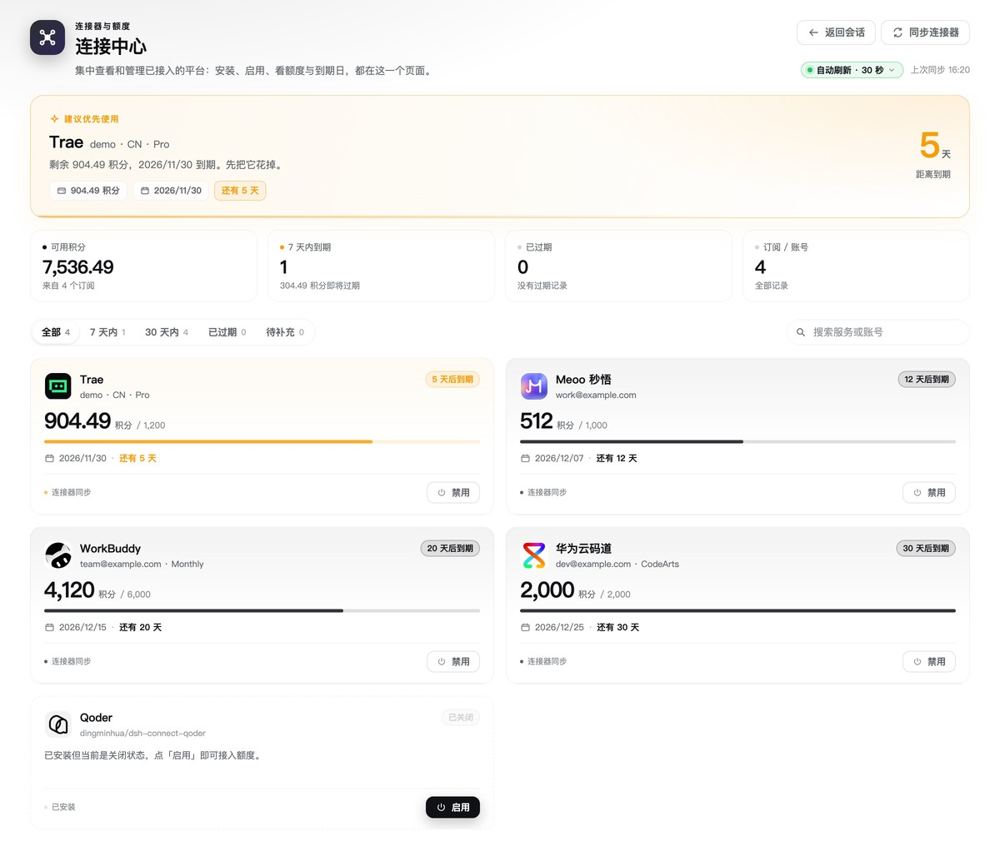
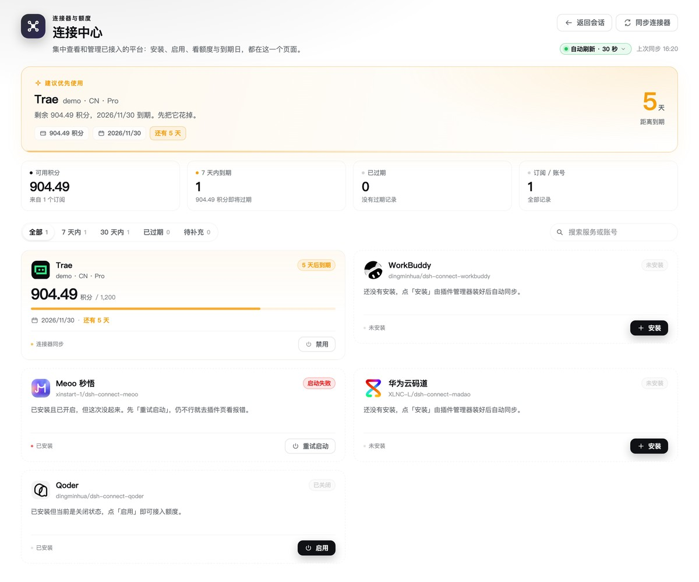
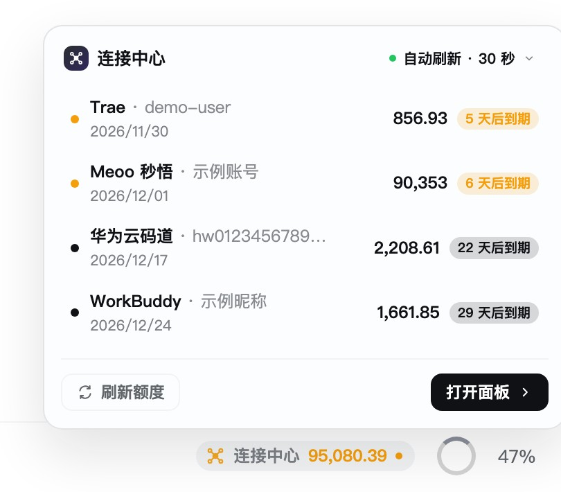
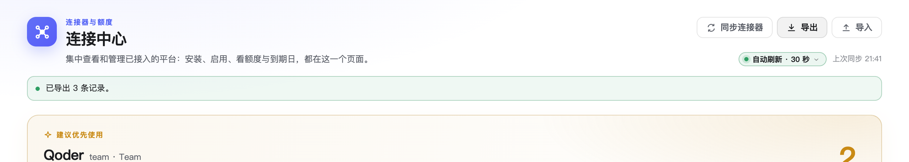

# 连接中心 · dsh-connect-hub

在 DeepSeek Harness 左侧栏增加一个「连接中心」入口，把**已接入的各个平台连接器**集中到一页管理：哪些装了、哪些开着、哪些没起来，一眼看清并直接操作；再把各账号的剩余积分和到期日排在一起，回答「下一笔该用哪个」。



平台清单目前是 Trae / WorkBuddy / Meoo 秒悟 / 华为云码道 / Qoder，**后续会继续接入更多平台**。

### 连接器状态就在卡片区里

没有单独的「支持的连接器」列表：某个来源有额度就显示额度卡片；没额度可显示的来源直接变成一张**连接器卡片**，长在同一个网格里，每种状态都带着唯一能修好它的那个动作。



- **未安装** → 「安装」，由 profile 自己的插件管理器执行
- **已关闭**（装了但没选中）→ 「启用」，只选中已有 bundle，**不重新下载**
- **启动失败**（选了但没起来）→ 「重试启动」
- **已接入** → 额度卡片底部带「禁用」，可直接关掉该连接器（记录保留）

「装了」和「开着」在 DSH 里是两个独立开关，所以判断依据是 **Cordis Loader 内存状态 + profile 的 bundle 清单**，而不是只看 Loader——只看 Loader 会把「装了但没选中」读成「未安装」。

### 对话栏底部的胶囊

不用打开面板也能看额度：输入框下方有一个「连接中心 95,080.39」的胶囊，点开就是按紧急程度排好的速览，一行一个账号，右边是余额和到期徽章。胶囊上的数字跟着同步结果实时变化，有订阅 7 天内到期时变警示色并带一个小圆点。



弹框里可以「刷新额度」或「打开面板」；点外面或按 Esc 就收起，所以没有单独的关闭按钮。右上角的「自动刷新 · 30 秒」点开就能改间隔。

> 图中的账号、昵称与积分均为示例数据，不是真实账号。

### 新增一个平台要改哪里

详见 [docs/CONNECTORS.md](docs/CONNECTORS.md)「新增第六个来源要改哪里」。

| 位置 | 改什么 |
|---|---|
| `client.js` `SYNC_SOURCES` | 加 `{ key, labelKey, load: syncX }` |
| `client.js` `syncX()` | 把该平台的接口结果映射成统一条目 |
| `client.js` `SOURCE_SERVICE` / `SOURCE_INFO` | 服务名与仓库链接 |
| `client.js` `BRAND_ASSETS` | 品牌图标（放 `lib/assets/brand/`，文件名带内容哈希） |
| `client.js` `BRAND_RETRIES` / `BRAND_RETRY_DELAYS` | 图标加载失败时的重试次数与间隔 |
| `client.js` `busyKeys` / `subscribers` | 每个连接器各自的重入锁，以及状态变更后推给各页面的订阅者 |
| `index.js` `CONNECTORS` | `{ key, module, package }`，状态与安装/开关都靠它 |
| `locale/*.json` + 内联 `ZH`/`EN` | 名称文案 |

## 安装

从 npm 装（推荐，装的是预构建代码，不需要任何构建授权）：

```sh
dsh plugin add dsh-connect-hub
```

不想经过 npm，也可以直接从仓库装，或装本地 tarball：

```sh
dsh plugin --profile desktop add github:KaenFelix/dsh-connect-hub
dsh plugin add ./dsh-connect-hub-1.0.4.tgz
```

装完在 **插件** 里确认 `dsh-connect-hub` 已启用。GitHub 方式取的是源码，没有构建步骤可跑，但本包是纯 JavaScript、没有 `build`，所以直接可用。

## 使用

1. 安装并启用本插件，刷新页面。
2. 对话栏输入框下方多了一个「连接中心 95,080.39」的小按钮：点一下就在这个按钮正上方弹出额度速览（和 DSH 自带的「会话统计」一样贴着按钮展开）——按紧急程度排好的订阅列表，每行显示积分、到期日和状态（弹框只放列表和刷新/打开两个动作，顶部三块统计数字只留在完整页面里）。右上角是「自动刷新 · 30 秒」，点开就能改间隔或关掉，弹框不再有单独的关闭按钮——点外面或按 Esc 就收起。间隔菜单会按弹框剩余高度自适应，不会盖住底部两个按钮。弹框里可以直接「刷新额度」，或点「打开面板」跳到完整页面。按钮上的数字实时跟随同步结果；有订阅 7 天内到期时，图标和数字会变成警示色并带一个小圆点。
3. 点击左侧栏的「连接中心」图标（或弹框里的「打开面板」）进入完整页面。
4. 页面默认开启「自动刷新」：打开页面时若数据已过期会立即读取一次，之后按设定间隔自动读取；窗口切回前台也会补一次。点右上角「自动刷新 · 30 秒」可改间隔（5 秒 / 10 秒 / **30 秒** / 1 / 2 / 3 / 5 分钟，**默认 30 秒**）或关掉；也可以随时点「同步连接器」手动读取。读取范围**固定为下面「同步来源」里的五个连接器**，不支持自动发现其他已安装的连接器。
5. 五个连接器**互不影响**：每个卡片只看自己的按钮状态，装 A 的时候 B 照样能点；Host 用文件锁串行化写 profile，所以并发点两个也只会排队执行，不会互相顶掉。装完的卡片**在同一帧**就从「安装中」变成「已接入」，不会先闪回一次「未安装」——重读 Host 状态在解除忙碌标记之前完成，中途那次渲染拿不到旧数据。
6. 连接器状态**不再单独占一块列表**，而是直接长在卡片区里：某个来源有额度就显示额度卡片；没有额度可显示的来源（没装、装了但关着、装了没起来）就以一张**连接器卡片**出现在同一个网格里，状态和动作一一对应——没装的点「安装」（由 profile 自己的插件管理器执行）；装了但关着的写「已关闭」并给「启用」（只选中已有 bundle，不重新下载）；装了、开着但没起来的写「启动失败」并可「重试启动」。已经接入的来源，其**第一张**卡片底部带「禁用」，可以直接关掉该连接器（记录保留，重新启用即恢复）。不会有任何一种状态被伪装成「未安装」。卡片左上角是**各平台自己的品牌图标**（Trae / WorkBuddy / Meoo 秒悟 / 华为云码道 / Qoder，图片随包分发在 `lib/assets/brand/`，不热链），不是首字母占位；不认识的来源才回落成首字母。图标取不到时（刚装完、Host 还没把这个包挂起来的那几秒）会自动重试，重试期间和重试用尽后都显示首字母，不会留一个空白方块。
7. 面板是只读的：没有手工录入，也没有编辑。数据只来自上面五个连接器；早先手动录入的记录仍会显示，但标注「旧手动记录（只读）」，不再能修改。右上角另有「导出 / 导入」，用来把已有记录和自动刷新设置搬到另一个浏览器（见下面「导出 / 导入设置」）。
8. 页面根据到期日自动排序：越早到期排越前；已过期排在可用额度之后；缺积分或缺到期日的条目归入「待补充」。
9. 同一账号的积分常常分批到期，排序看的是「最早会作废的那一批」：例如某账号整包 30 天后到期，但其中 100 积分 7 天后就过期，它仍然排在 10 天后到期的订阅前面。卡片会用「部分 7 天后到期」和「其中 100 积分 7 天后到期」标出这批积分，顶部「7 天内到期」也只统计真正会在这周作废的额度。

## 导出 / 导入设置

页面右上角「同步连接器」右边多了两个按钮：**导出**把当前记录和自动刷新设置写成一个 JSON 文件，**导入**从这样的文件里读回来。换浏览器、换机器、或者清理站点数据之前，用它代替手工重填。



- 导出文件名形如 `dsh-connect-hub-20261126-2141.json`，内容是 `{ kind, version, exportedAt, auto, entries, lastSyncedAt }`。`entries` 就是 `localStorage` 里那份记录，字段不重命名，所以文件本身也是一份可读的备份。
- **导入是合并，不是覆盖**：先按 `sourceKey` 找同一条记录，找不到再按「服务名 + 账号」匹配，都对不上的才追加。同一个账号不会因为导入多出一张卡片。
- **较新的数据赢**：匹配上时比较两边的 `updatedAt`，文件比本地旧就跳过这条。所以拿一个旧文件盖新数据不会把余额倒回去。
- 空字段不覆盖已有值：文件里 `account` 是空串、`credits` 是 `null` 时，保留本地已有的账号和余额。
- 文件里带的 `auto` 会一并应用（开关与间隔），所以导出的那份设置能原样搬到新环境。
- 导入**不更新**「上次同步」时间戳：导入不是同步，把时间戳往前推会让自动刷新以为数据是新的。
- 容错按情况给句子，不会静默失败：不是 JSON、不是本插件的备份、来自更新版本（`version` 更高）、文件里没有记录、记录全都缺字段，各有各的提示；个别记录缺字段时其余照常导入，并说明跳过了几条。
- 也接受一个裸数组（`[{ "service": "Trae", ... }]`），手工写几条记录直接导入即可。

文件里只有积分、到期日和设置——**没有连接器的登录态**。登录信息在各自连接器的存储里，本插件既读不到也不会导出。

## 同步来源

连接中心只认识一张写死在代码里的来源表（`SYNC_SOURCES`，[client.js:1586](client.js#L1586-L1592)），**不枚举已安装的插件**。五个来源如下，接口地址与字段解析各自写死在 `syncTrae` / `syncWorkBuddy` / `syncMeoo` / `syncMadao` / `syncQoder` 里：

| 服务 | 连接器包 | 仓库 | 读取的接口 |
|---|---|---|---|
| Trae | `dsh-connect-trae`（4.18.8） | [dingminhua/dsh-connect-trae](https://github.com/dingminhua/dsh-connect-trae) | `/plugins/dsh-connect-trae/usage` 与 `/account-credits`（**仅 `region=cn`**） |
| WorkBuddy | `dsh-connect-workbuddy`（5.31.2） | [dingminhua/dsh-connect-workbuddy](https://github.com/dingminhua/dsh-connect-workbuddy) | `/plugins/dsh-connect-workbuddy/account-credits` 与 `/usage`（`cn` + `global`） |
| Meoo 秒悟 | `dsh-connect-meoo`（0.0.6） | [xinstart-1/dsh-connect-meoo](https://github.com/xinstart-1/dsh-connect-meoo) | `/plugins/dsh-connect-meoo/status` |
| 华为云码道 | `@yzdys/dsh-connect-madao`（0.12.0） | [KaenFelix/dsh-connect-madao](https://github.com/KaenFelix/dsh-connect-madao) | 本机桥接服务 `http://127.0.0.1:8765/diag/account`（不走 DSH 路由） |
| Qoder | `@dmh2002/dsh-connect-qoder`（1.27.1） | [dingminhua/dsh-connect-qoder](https://github.com/dingminhua/dsh-connect-qoder) | `/plugins/dsh-connect-qoder/usage` 与 `/account-credits`（`cn` + `global`） |

几个实现细节：

- Trae 连接器本身还有 `enterprise` / `ai` 两个面板，连接中心没读；码道走的是它自己起的 8765 桥接服务，桥接没起或改了 `config.port` 时这一路必然失败。
- **Qoder 的积分到期只看签到批次。** 连接器的 `credits.total` 是**剩余**之和（进度条分母用 `packages[].size`），批次到期只出现在 `usage.pool.accounts[].nearestExpiryMs` + `expiringSoon`（临期**金额**）；`planExpiresAtMs`（套餐结束）**不**拿来冒充积分到期日——两者在连接器里是刻意分开的，用错会把 Qoder 排到错误位置。没有批次时该条进「待补充」。
- **这五个之外的连接器即使已登录、接口能返回积分，连接中心也不会读取。** 新增来源要改的位置、以及为什么不改成自动发现，见 [docs/CONNECTORS.md](docs/CONNECTORS.md)。

### 只同步「装好且开着」的连接器

在「插件」里关掉某个连接器（或根本没装）时，连接中心会跟着闭嘴：不再探测它的接口，不再报「未响应」，把它的额度卡片和统计一起收起来，并在卡片区留下一张写着「已关闭」的连接器卡片（带「启用」按钮）。依据是 Host 读的 **Cordis Loader 内存状态 + profile 的 bundle 清单**（`GET /plugins/dsh-connect-hub/connectors`），不是去试接口——所以不会因为一次网络抖动就把来源误判成关掉。

两个来源都要读，是因为 DSH 里「装了」和「开着」是两个独立开关：bundle 没被选中时 Loader 里一行都没有，只看 Loader 会把它当成「未安装」，而它的文件其实就在 `node_modules` 里。

- 被隐藏的只是**显示**：`localStorage` 里的记录一条都不删，连接器重新开启后卡片立刻回来。
- 手动录入的条目不隐藏；Host 报告不到的来源当作「未知」，也不隐藏。
- **Host 不回答时全部放开**（老 Host / 非 Desktop / 读取失败）：退回「每个来源都试」，和改动前一致。宁可能试一次，也不静默吞掉用户账号。
- 页面不再单独提示「X 已关闭，相关卡片已隐藏」：连接器卡片自己就写着「已关闭」并带「启用」按钮，原因和办法在同一处。
- 同步结果区分三件事：全部关闭 → 「已关闭或未安装，本次没有读取」；响应但零条 → 「已响应但没有账号（可能未登录）」；请求失败 → 「未响应」。

## 数据与限制

- 订阅数据保存在当前浏览器的 `localStorage`（键名 `dsh-connect-hub:v1`；旧版 `dsh-credit-radar:v1` 里的数据会在首次打开时自动搬过来，然后旧键被删除），不写入 DSH profile，也不会上传到远端。页面和对话栏的小按钮读同一份数据，任何一处同步完，另一处立刻跟着更新。
- 同步只调用连接器已有的只读接口，不消耗积分、不切换账号、不修改上游状态。
- 同步会清理「改名残留」：连接器换了账号标识（比如 Trae 早先按账号名建键、现在按 accountId 建键）时，旧记录会被新记录覆盖并自动删除，不会在「待补充」里留一张重复卡片。
- 同步是「尽力而为」：连接器未安装、被禁用、未登录或当前页面不是本机回环地址时，对应来源会失败或返回空；此时只能等连接器恢复，页面本身不提供手工录入（历史手动记录仍会显示）。
- 自动刷新在「连接中心」页面或对话栏那个小按钮任一处挂着时运行（按设定间隔，安静更新，不弹提示），两处都关掉才停止；开关与间隔保存在 `dsh-connect-hub:auto`（旧键 `dsh-credit-radar:auto` 同样自动迁移），不会发送系统通知。间隔越短，对连接器接口的请求越频繁——最低 5 秒是为「刚花完一笔积分想立刻看到余额」准备的，日常用默认的 30 秒就够。
- 分批到期数据来自连接器本身：Trae 用积分包（`credits.accounts`）、WorkBuddy 用套餐列表（`usage` 里的 `packages`，月度包按重置日算）、Meoo 用 `grants`、Qoder 用签到批次（`pool.accounts[].nearestExpiryMs` + `expiringSoon`）；华为云码道只提供套餐整体到期日，拆不出批次，仍按整包到期日排序。
- 优先级只看到期日，不按积分单价或模型倍率计算；同一天到期时，剩余积分少的排前面，避免浪费。
- 卡片不可编辑是刻意的：同步会整体覆盖积分、到期日和套餐字段，编辑同步条目下一次同步就会丢失，所以干脆不提供入口。
- 清除浏览器站点数据会删除本插件里的记录（包括遗留的手动记录）。
- 包名选 `dsh-connect-hub` 是因为 `dsh-connect` 已被一个飞书/Telegram 桥接插件占用，换个名字免得两边混淆。仓库在 [KaenFelix/dsh-connect-hub](https://github.com/KaenFelix/dsh-connect-hub)（本地目录名仍是旧的 `dsh-credit-radar`），已发布在 npm 的 [dsh-connect-hub](https://www.npmjs.com/package/dsh-connect-hub)，也提供 `dsh-connect-hub-1.0.4.tgz` 作为离线安装包。